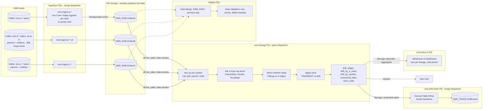

# 02 — Target architecture

The revised design for A → B → C order tracing on Deephaven Enterprise, for the five-level
topology of doc 01 §1. It keeps the goals of the source document and replaces its resolver /
mapping-table / pending-buffer machinery with one lineage DAG over durably ingested tables
(doc 00 F2–F5). Requirement ids are doc 01's.

---

## 1. Design principles

1. **Ingest dumb, persist first, compute inside the engine.** Each system's feed lands in a
   Data Import Server as a partitioned intraday table before anything reads it (R1). All
   linking, reconciliation and aging are declarative table operations in one update graph.
2. **Pending is a state, not a place.** A child whose parent has not arrived is a row with
   `ParentState = UNRESOLVED`; a node whose chain to A is broken higher up has
   `RootState = UNRESOLVED`. Both heal in the update cycle the missing node lands (R8). The
   durable copy is the raw table (R10).
3. **Reconcile per edge, attribute by edge.** Parent against Σ direct children on each of the
   four edges; a cross-system edge names the system that is short, an in-system edge names the
   book inside the system (R4, R5).
4. **One worker until a measured gate trips.** The whole lineage (five levels, four edges, the
   root walk) runs in one Core+ worker first. Sharding, when needed, is per edge by the
   parent's id, with root ids flowing down between shard families as partitioned maps (doc 06).
5. **Cross-worker tables by the right mechanism.** Persisted tables through a DIS where
   history or replay matters; Barrage subscriptions only for small current-state tables (doc
   00 F4).
6. **Everything is a PQ, every parameter is configuration, every script is in Git** (R14, N9).

## 2. Topology

### 2.1 The order chain

```
A_ROOT (A)  1─1  B_PARENT (B)  1─n  B_CHILD (B)  1─1  C_PARENT (C)  1─n  C_CHILD (C, street)
    └── edge A-Bp ──┘   └── edge Bp-Bc ──┘  └── edge Bc-Cp ──┘  └── edge Cp-Cc ──┘
        cross-system        inside B            cross-system        inside C
```

Two raw tables (B, C) each hold two levels; the adapter splits them by role (`ParentOrderId`
null = parent). Root resolution is four `natural_join`s top-down; every node ends up with
`RootId` (the A order) or `RootState = UNRESOLVED`.

### 2.2 The platform



Compared with the source document's figure: DIS-A/B/C become three ingester PQs that each
embed a DIS; the resolver worker, the mapping-table publisher, the pending-buffer PQ and the
reconciliation PQ are gone; the shard workers are a later phase of the same lineage PQ
(doc 06 §4), not a separate design.

## 3. Component inventory

| Component | Enterprise mechanism | State it owns | Heap class | Restart behaviour |
|---|---|---|---|---|
| `oms-ingest-<x>-<topic>` | one Core+ Kafka ingester per topic (Q6: up to 8 per system, ~10 k msg/s each), grouped a few per "Live Query - Merge Server" PQ by measured parse throughput; in-worker DIS with private storage claiming the system's `OMS_RAW` tables | nothing beyond the DIS checkpoint (Kafka offsets, optional lastBy state) | small (2–4 GB per PQ; more with a lastBy view) | resumes from the checkpoint offset; exactly-once |
| `OMS_RAW.Orders<X>[_<topic>]` | intraday partitions (`Date`) in DIS storage, served through the Table Data Service; merged nightly. One table per system if the release lets each topic's ingester write its own internal partition of it, else one table per topic merged in the adapter (doc 05 §4.6) | the raw history (R1, R10); B and C hold parents and children | storage | n/a |
| `oms-ingest-<x>-execs` (P2b) | the same ingester mechanism on `oms.<x>.execs` → `OMS_RAW.Execs<X>` (a second `consume` in the system's ingester PQ, or its own PQ) | DIS checkpoint | small | resumes from the checkpoint |
| `OMS_RAW.ExecsA/B/C` (P2b) | intraday partitions, `OrderId` a grouping column | execution reports (R15); read lazily by `oms-lineage` for broken edges only | storage | n/a |
| `oms-lineage` | Live Query (Script) PQ, Core+ Python | the lineage DAG (doc 04): last state, role split, four links, four edges, aging, aggregates | sized by doc 06 §1, 64–128 GB at N1 | full recompute from the `Date` window; recovery time N6 |
| `oms-drift-writer` | Live Query - Merge Server PQ running a Derived Table Writer on a Barrage subscription to `break_events` | `OMS_TRACE.DriftEvents` | small | DTW resumes from its checkpoint |
| `oms-trace-ui` | Live Query (Script) PQ with `deephaven.ui`; Core+ client `barrage_subscribe` to aggregates and a filtered node slice | nothing durable | small–medium | re-subscribes |
| `oms-merge-raw`, `oms-validate-raw` | Data Merge / Data Validation PQs | historical partitions | n/a | re-runnable |
| Alert sink | table listener in `oms-lineage`: every threshold crossing becomes a row in the `alerts` table and one HTTP POST to `OMS_TRACE_ALERT_URL` (Q9: a table plus one HTTP sink) | dedupe state (in-memory; durable copy in `DriftEvents`) | — | re-alerts only on new crossings |

## 4. Data flow, end to end

1. **Ingest.** Each OMS publishes full order states (A2) on several topics (Q6), parents and
   children together (Q18), each order on one topic for life (A16). The ingester PQ deserializes, rejects malformed records to a
   counted reject log, stamps `RecvTs` and offsets, appends to the current `Date` partition and
   checkpoints (doc 05 §4–5).
2. **Last state and role split.** `oms-lineage` opens the three live tables over the `Date`
   window, keeps `last_by("OrderId")` per raw table, and splits B and C into parent and child
   levels on `ParentOrderId` (A11). Five level tables.
3. **Link, top-down.** `B_PARENT` joins `A_ROOT` on the A id; `B_CHILD` joins `B_PARENT` on
   the in-system parent id; `C_PARENT` joins `B_CHILD` on the B child id; `C_CHILD` joins
   `C_PARENT`. Each join carries the parent's `RootId` down, so every node gets its A root or
   `RootState = UNRESOLVED` (R3, R8).
4. **Roll up and gap.** On each edge, children are summed by their parent id and joined back:
   `FillGap = CumQty − ChildCumQty` and, since every system reports open quantity (Q14),
   `RouteGap = LeavesQty − ChildLeavesQty`. The 1 : 1 edges also check `ChildCount` (R4, R13, R16).
5. **Age, and check the feeds.** Only rows with a gap or without a parent join a slow clock; a
   row is `TRANSIENT` until neither side has moved for the aging threshold (R6). Per topic, the
   newest receive and event times give a channel state — `CURRENT`, `STALE` (silent) or
   `CATCHING_UP` (replaying a backlog, Q7) — and a gap with a non-current channel on either side
   is `FEED_STALE`: shown, counted, never paged as drift (R17).
6. **Aggregate.** `drift_by_a_order` (per root, one column per edge), `drift_by_symbol`,
   `unresolved_links`, `trace_stats` (R7, R9).
6b. **Name the executions (P2b).** For each parent with an aged gap, the parent's execution
   reports and the union of its children's are restricted with `where_in`, netted of busts,
   keyed on `(Qty, Px, TransactTime)` and compared as multisets; the side with more of a key
   names the dropped executions, and `Unexplained` says whether the execution picture accounts
   for the quantity gap (R15, doc 04 §10).
7. **Persist and alert.** Transitions form a blink table the drift writer appends to
   `OMS_TRACE.DriftEvents`; threshold crossings go to the alert sink (R10, R9).
8. **Serve.** The UI PQ subscribes to the aggregates and to a node slice for the user's
   selection and builds the five-level tree for those roots only (R12).
9. **Nightly.** Merge, validate, delete; the lineage PQ restarts at a quiet time so its window
   rolls (doc 07 §7).

## 5. Out-of-sequence handling as states

```
 child arrives, parent absent         parent arrives (same cycle)          chain above completes
 ParentState = UNRESOLVED  ─────────────────────────────►  LINKED  ──────────────────────────► RootState = RESOLVED
          │                                                   │ (RootState may still be UNRESOLVED
          │ age ≥ alert threshold                             │  if a higher hop is missing)
          ▼                                                   ▼
 UNRESOLVED (alerted)                      FillGap != 0 and both sides quiet ≥ aging threshold → drift
```

- A `C_CHILD` whose `C_PARENT` is present but whose `B_CHILD` is missing is `LINKED` with
  `RootState = UNRESOLVED`: it reconciles against its parent (the `Cp-Cc` edge is local) but
  cannot be attributed to an A order until the chain heals. It is listed, not alerted; the alert
  is on the unresolved `C_PARENT` above it.
- No message is re-read, re-queued or retried at any transition.

## 6. Where tables cross workers

| From → to | Mechanism | Why |
|---|---|---|
| ingester PQs → `oms-lineage` | DIS storage read through the Table Data Service (`db.live_table`) | the full stream with history; replayable; no snapshot cost on the ingesters |
| `oms-lineage` → `oms-trace-ui` | Barrage subscription to **small** tables: aggregates, `unresolved_links`, a filtered node slice | current state only; subscriber holds a full copy |
| `oms-lineage` → `oms-drift-writer` | Barrage subscription to a **blink** table, persisted by a Derived Table Writer | history matters, so it goes to a DIS |
| shard families → the next family (P3 only) | partitioned `(child id → RootId)` maps, Barrage slices or persisted lastBy tables | doc 06 §4 |

## 7. Delivery phases

| Phase | Scope | Exit gate |
|---|---|---|
| P0 Community prototype | the lineage DAG on mock and replayed samples; Python reference oracle; 1 M-node sizing run; the fix42 `order_tree_recon` module runs this exact topology out of the box (doc 10 §3) | AC1–AC4 against the oracle; per-node memory measured |
| P1 Enterprise ingest + lineage | three ingester PQs, `OMS_RAW` schemas, one lineage PQ, nightly merge | AC5–AC7 on UAT |
| P2 Outputs | drift writer, UI PQ, alert sink, ACLs | desks sign off on attribution (R5) |
| P2b Executions | execution ingesters, `OMS_RAW.Execs*`, the lazy execution match, `exec_breaks` in the UI and in `DriftEvents` | AC9; pre-cutover match rate at the configured precision ≥ 99.9 % (doc 09 §6) |
| P3 Scale | load test at N1; shard per edge only if a gate trips | AC8 |
| P4 Cutover | prod PQs, runbooks, dashboards | doc 10 §6 |

## 8. Enterprise versus Community in this design

| Capability | Community | Enterprise (used here) |
|---|---|---|
| Table operations (`last_by`, `natural_join`, `agg_by`, `where`, `tree`) | yes | same engine in Core+ |
| Durable, replayable Kafka ingestion with exactly-once resume | roll your own | Core+ Kafka ingester with an in-worker DIS |
| Partitioned on-disk tables served live to many workers | Parquet + custom | DIS intraday/historical, Table Data Service, `db.live_table` |
| Long-running managed workers with schedules, heap, ACLs, restarts | Application Mode, external supervisor | Persistent Queries |
| Persisting derived tables with checkpoints | custom | Derived Table Writer, user tables |
| Cross-worker live tables | Barrage via `deephaven.uri` / clients | Barrage via the Core+ client, in-worker |
| Access control by namespace/table | none | ACLs, system/user namespaces |
| Nightly merge/validate | custom | Data Merge and Data Validation PQs |

Glossary for the terms used above: **DIS** — Data Import Server, writes and serves intraday
partitions; **Core+** — Enterprise workers running the Community engine; **PQ** — Persistent
Query, a managed long-running worker.

## 9. Decision log

| # | Decision | Alternatives rejected | Doc |
|---|---|---|---|
| D1 | Per-edge reconciliation on four edges, 1 : 1 edges also checked for cardinality | per-row triple diff (false drift under the 1 : n edges) | 00 F1, 03 §6 |
| D2 | Late parents handled by incremental joins; `UNRESOLVED` and `ROOT_UNRESOLVED` states | resolver + pending buffer + retry PQ | 00 F2, 04 §4 |
| D3 | No mapping-table service | Barrage-published 100 M-pair table | 00 F4 |
| D4 | Kafka → Core+ ingester with in-worker DIS per system | tailer-based "DIS-A/B/C"; Deephaven→Kafka re-publish | 00 F5, 05 |
| D5 | One lineage worker first; shard per edge by parent id with partitioned root maps flowing down when a gate trips | hash(root) shards with a resolver on the message path | 00 F3, 06 §4 |
| D6 | Aging over receive time; transient gaps are not drift | instantaneous diff | 00 F12, 04 §5 |
| D7 | Drift history via DTW to `OMS_TRACE`; consumers subscribe to small aggregates | everything over Barrage; everything via Kafka | 02 §6, 05 §8 |
| D8 | Native id columns for joins; synthetic `NodeKey` strings only in UI slices | `System + "|" + OrderId` on 100 M rows | 06 §1 |
| D9 | Role split on `ParentOrderId` inside the adapter: null = parent, non-null = child (Q15, answered 2026-10-26); an empty string is a `NO_LINK` child, never a silently misfiled parent | separate parent/child tables from the feeds; a role/type column | 03 §3, Q18 |
| D10 | Python Core+ scripts from Git; a Python reference oracle tested row for row | Groovy; untested formulas | 09, 10 |
| D12 | Open quantity reconciled per edge too (`RouteGap`): `HELD` amber on in-system edges, `OVER_ROUTED` / `CHILD_STILL_OPEN` red, `LEAVES_MISMATCH` red on the 1 : 1 edges (Q14 answered 2026-10-26) | executed quantity only | 03 §6, 04 §3 |
| D13 | One topic and one raw table per system, parents and children split by `ParentOrderId` (Q18); parent-before-child arrival is assumed within a system (Q7) but, with topics keyed by order id (Q11), holds per partition only, so the design does not rely on it | two topics / two tables per system | 03 §2, 05 §4 |
| D14 | Aging clock configurable: receive time by default, event time (GMT tag 60, comparable across systems, Q12) as an option; the execution match key always uses event time | event time only (a republished old report would age instantly) | 03 §7 |
| D15 | Per-channel feed health in the lineage DAG: a stale or catching-up topic suppresses the gaps it touches as `FEED_STALE` with one alert per topic (Q7 answered 2026-10-26) | paging on every gap during an outage; suspending the whole view while any feed is down | 03 §4.4, 04 §5, 08 §3 R8 |
| D11 | Execution-level identification by **multiset match on `(Qty, Px, TransactTime)`**, computed **lazily for parents with an aged gap** (`where_in`), busts netted by `ExecRefId` | matching every execution on every edge (O(executions) heap); matching by exec id (ids do not cross hops, Q17) | 02 §10, 04 §10, 06 §1.5 |

## 10. Execution-level identification (R15, Q17)

Cumulative-quantity states say *which edge* is short and *by how much*. To say *which
execution*, each system's execution reports are ingested too (`OMS_RAW.Execs<X>`, doc 03 §2.1)
and compared per edge. Q17 fixes the matching rule: ids do not cross a hop, so an execution is
the same execution on both sides when its **quantity, price and transaction time** agree at
the configured precision.

Three design choices keep this affordable and honest:

1. **Lazy.** The comparison runs only for parents that already have an aged quantity gap
   (`where_in` on `gaps`). Execution rows outnumber order states several to one; a per-key
   count over all of them would cost heap proportional to executions. Restricted to broken
   edges it costs heap proportional to breaks, and the raw execution tables stay on disk.
2. **Multiset.** Two identical fills are two rows: counts per `(ParentId, Qty, PxKey, TimeKey)`
   on each side are compared, and the difference names how many of that key are missing and
   on which side. When k of n identical fills are missing the row names all n candidates and
   flags `Ambiguous`; that is the limit of what the key can say.
3. **Busts netted first.** A bust or correction removes the execution it references
   (`ExecRefId`, within its own system) before matching. An unpropagated bust therefore shows
   up as an execution present on one side only, which is exactly the break it is.

Outputs: `exec_breaks` (one row per edge, parent and key with a non-zero difference, naming
the dropped exec ids) and `exec_breaks_by_edge` (per broken parent: the gap the executions
explain and the `Unexplained` residue, non-zero when quantities, prices or times disagree
rather than executions being missing). Both go to the UI's break panel and, as transitions, to
`OMS_TRACE.DriftEvents`. The pre-cutover check measures the match rate at exact, 1 ms and 1 s
precision so the time bucket is set from data, not hope (doc 09 §6).
