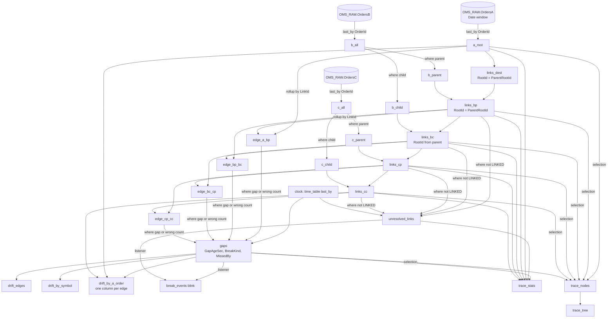

# 04 — The lineage and drift DAG

The Deephaven table graph that turns three raw tables into the doc 03 outputs for the
six-level chain `A_ROOT → A_DEST → B_PARENT → B_CHILD → C_PARENT → C_CHILD` (A's client-side
and destination-side orders, then B, then C). It is written for a
Core+ Python worker on Deephaven Enterprise 2026.01.054 (release line 1.202601, Community Core
42.5 engine, Q10); every operation is Community Core, so the same code runs in a Community
server of that engine version for the prototype (doc 10 M1) with the three source tables swapped.

The structure is the one the fix42 repo's doc 14 proved for Raptor → algo → router, which is
this topology one for one (client / algo parent / algo child / router parent / router child).
The production form below specializes it to the fixed six levels and joins on native id
columns (doc 02 D8). §8 shows how to run the generic `order_tree_recon` module instead.

---

## 1. Inputs, last state and the role split

```python
# oms-lineage PQ (Core+ Python). `db` is the worker's Enterprise database object.
import os
from deephaven import agg, merge, time_table

RAW_NS    = os.environ.get("OMS_TRACE_RAW_NAMESPACE", "OMS_RAW")
WINDOW    = int(os.environ.get("OMS_TRACE_DATE_WINDOW_DAYS", "2"))
AGE_SEC   = int(os.environ.get("OMS_TRACE_GAP_AGE_SEC", "30"))
UNRES_SEC = int(os.environ.get("OMS_TRACE_UNRESOLVED_ALERT_SEC", "3600"))
CLOCK     = os.environ.get("OMS_TRACE_CLOCK_SEC", "30")
PARENT_ID = os.environ.get("OMS_TRACE_PARENT_ID_COLUMN", "ParentOrderID")

def date_window(days: int) -> list[str]:
    """today-(days-1) .. today, plus tomorrow so the midnight rollover needs no restart."""
    from datetime import date, timedelta
    today = date.today()                       # the worker runs in OMS_TRACE_TZ (doc 07 §6)
    return [str(today + timedelta(d)) for d in range(-(days - 1), 2)]

DATES = ", ".join(f"`{d}`" for d in date_window(WINDOW))

def raw_table_names(kind: str, system: str) -> list[str]:
    """`Orders<X>` (one table, every topic's ingester in its own internal partition) or, in the
    fallback layout, `Orders<X>_<topic>` per topic from OMS_TOPICS_<X> (doc 05 §4.3b)."""
    topics = [t for t in os.environ.get(f"OMS_TOPICS_{system}", "").split(",") if t]
    one_table = os.environ.get("OMS_TRACE_ONE_TABLE_PER_SYSTEM", "true") == "true"
    return [f"{kind}{system}"] if one_table or not topics else [f"{kind}{system}_{t.rsplit('.', 1)[-1]}" for t in topics]

def raw(kind: str, system: str):
    # Partition filter first: the Date column prunes partitions before any row is read.
    parts = [db.live_table(RAW_NS, n).where(f"Date in {DATES}") for n in raw_table_names(kind, system)]
    return parts[0] if len(parts) == 1 else merge(parts)

def last_state(system: str):
    # One last_by per system over all its topics (B and C hold two levels each): one row per order.
    return raw("Orders", system).last_by(["OrderId"])

IS_PARENT = f"isNull({PARENT_ID})"     # Q15: null = parent, non-null = child (doc 03 §3)

def canon(level: str, system: str, link: str | None):
    link_expr = "``" if link is None else f"isNull({link}) ? `` : {link}"
    return [
        f"Level = `{level}`", f"System = `{system}`",
        "OrderId",
        f"LinkId = {link_expr}",
        "Symbol = isNull(Symbol) ? `` : Symbol",
        "Side = isNull(Side) ? `` : Side",                # one coding across systems (Q13): compared as sent
        "OrderQty = isNull(OrderQty) ? 0L : OrderQty",
        "CumQty = isNull(CumQty) ? 0L : CumQty",
        "LeavesQty = isNull(LeavesQty) ? 0L : LeavesQty",
        "Status = isNull(OrdStatus) ? `` : OrdStatus",
        "RecvTs",
        "Topic = isNull(Topic) ? `` : Topic",            # the drop-copy channel, for the feed check (Q7)
        # the aging clock: receive time by default; event time (tag 60, GMT, Q12) when OMS_TRACE_AGE_CLOCK=event
        "AgeTs = " + ("TransactTime" if os.environ.get("OMS_TRACE_AGE_CLOCK", "recv") == "event" else "RecvTs"),
        "Present = true",
    ]

a_all, b_all, c_all = last_state("A"), last_state("B"), last_state("C")

a_root   = a_all.view(canon("A_ROOT", "A", None))
b_parent = b_all.where(IS_PARENT).view(canon("B_PARENT", "B", "UpstreamRef"))
b_child  = b_all.where(f"!({IS_PARENT})").view(canon("B_CHILD", "B", PARENT_ID))
c_parent = c_all.where(IS_PARENT).view(canon("C_PARENT", "C", "UpstreamRef"))
c_child  = c_all.where(f"!({IS_PARENT})").view(canon("C_CHILD", "C", PARENT_ID))
```

Why `last_by` before the split and the `view`: the `view` is lazy and `last_by` only needs the
key column, so the adapter formulas are evaluated on one row per order rather than one per
message, and B's and C's two levels cost one pass each. A system's several topics (Q6) are one
input: `last_by` over their union keeps the latest state per order whichever topic carried it
(A16).

## 2. Link each level to its parent, top-down, carrying the root

```python
PARENT_COLS = [
    "ParentPresent = Present",
    "ParentCumQty = CumQty",
    "ParentSymbol = Symbol",
    "ParentSide = Side",
    "ParentStatus = Status",
    "ParentRecvTs = RecvTs",
    "ParentRootId = RootId",
]
STATE_COLS = [
    "ParentState = LinkId == `` ? `NO_LINK` : (isNull(ParentPresent) ? `UNRESOLVED` : `LINKED`)",
    "RootState = isNull(RootId) ? `UNRESOLVED` : `RESOLVED`",
    "UnresolvedSince = ParentState == `UNRESOLVED` ? RecvTs : null",
]

def link(children, parents, root_formula: str, parent_system: str):
    return (
        children.natural_join(parents, on=["LinkId=OrderId"], joins=PARENT_COLS)
        .update_view([root_formula, f"ParentSystem = `{parent_system}`"] + STATE_COLS)
    )

a_root     = a_root.update_view(["RootId = OrderId", "RootState = `RESOLVED`", "ParentState = `ROOT`"])
links_dest = link(a_dest,   a_root,     "RootId = ParentRootId", "A")   # the destination order names its client order (tag 5011)
links_bp   = link(b_parent, links_dest, "RootId = ParentRootId", "A")   # null while A's destination order is missing
links_bc   = link(b_child,  links_bp,   "RootId = ParentRootId", "B")   # null while the B parent is missing
links_cp   = link(c_parent, links_bc,   "RootId = ParentRootId", "B")
links_cc   = link(c_child,  links_cp,   "RootId = ParentRootId", "C")
```

Five joins resolve every node's root, each from the row above it. `natural_join` requires unique keys on the right;
`last_by("OrderId")` guarantees it. Should a feed violate A1 (two live orders with one id), the
join would throw and take the PQ down, so the adapter's `last_by` is also the guard that keeps
the DAG alive.

A5 and A6 are confirmed (Q4: references are replace/cancel-invariant root ids; Q5: no hop is
skipped), so one `natural_join` per level is the production form. Should either change, doc 14's
id index and ordered candidate parents (the generic path in §8) replace the single join without
changing anything downstream.

## 3. Roll up direct children and compute the edge gap

```python
def children_rollup(children):
    return children.where("LinkId != ``").agg_by(
        [agg.count_("ChildCount"),
         agg.sum_(["ChildCumQty = CumQty", "ChildLeavesQty = LeavesQty"]),
         agg.max_(["ChildLastTs = AgeTs"]),
         agg.distinct(["ChildTopics = Topic"])],        # the channels the children came from (§5 feed check)
        by=["LinkId"],
    )

def edge(parents, children, name: str, scope: str, expect_one: bool, child_system: str):
    return (
        parents.natural_join(children_rollup(children), on=["OrderId=LinkId"],
                             joins=["ChildCount", "ChildCumQty", "ChildLeavesQty", "ChildLastTs", "ChildTopics"])
        .update_view([
            "ChildCount = isNull(ChildCount) ? 0L : ChildCount",
            "ChildCumQty = isNull(ChildCumQty) ? 0L : ChildCumQty",
            "ChildLeavesQty = isNull(ChildLeavesQty) ? 0L : ChildLeavesQty",
            "FillGap = CumQty - ChildCumQty",
            "RouteGap = LeavesQty - ChildLeavesQty",        # open quantity, Q14 (doc 14's RouteGap)
            "LastChangeTs = isNull(ChildLastTs) || epochNanos(AgeTs) > epochNanos(ChildLastTs) ? AgeTs : ChildLastTs",
            f"Edge = `{name}`", f"Scope = `{scope}`", f"ExpectOne = {'true' if expect_one else 'false'}",
            f"ChildSystem = `{child_system}`",
        ])
    )

edge_a_bp  = edge(a_root,   links_bp, "A-Bp",  "CROSS",    True,  "B")
edge_bp_bc = edge(links_bp, links_bc, "Bp-Bc", "INTERNAL", False, "B")
edge_bc_cp = edge(links_bc, links_cp, "Bc-Cp", "CROSS",    True,  "C")
edge_cp_cc = edge(links_cp, links_cc, "Cp-Cc", "INTERNAL", False, "C")
```

Only **direct** children are summed. Comparing A with Σ `C_CHILD` would count every
intermediate level's shares again; the four edge gaps telescope to the A-vs-street number
anyway (doc 03 §6), and each one names a book.

## 4. How a late parent heals (the replacement for the pending buffer)

Timeline for a C parent whose B child arrives two hours later:

| t | event | `links_cp` for Cp1 | `links_cc` for Cp1's children | `edge_bc_cp` | `unresolved_links` |
|---|---|---|---|---|---|
| T | Cp1 ingested (`LinkId = Bc1`), Cc rows ingested | `ParentState = UNRESOLVED`, `RootId = null` | `LINKED` to Cp1, `RootState = UNRESOLVED` | no Bc1 row | Cp1, age growing |
| T + 1 h | nothing | unchanged; `AgeSec` grows at each clock tick | unchanged | — | Cp1 `Alerted` after 3600 s |
| T + 2 h | Bc1 ingested | **modified** in the same cycle: `LINKED`, `RootId = A1` (from Bc1 → Bp1 → A1) | **modified**: `RootState = RESOLVED`, `RootId = A1` | Bc1 row added: `ChildCount = 1`, `FillGap = Bc1.CumQty − Cp1.CumQty` | Cp1 removed |
| T + 2 h | Bp1 already present | — | — | `edge_bp_bc` for Bp1 gains Bc1 in its rollup | — |

The `Cp-Cc` edge was reconciling the whole time: Cp1 against its children is local to C and
needs no B. Nothing was scheduled, re-read or re-published. The engine's join state is the
pending buffer, the raw `OrdersC` partition is its durable copy, and a lineage-PQ restart
replays the same healing by recomputing the joins over the window (doc 08 §3 R2).

What the window must cover: a parent that arrives on a later `Date` than its child links only
if both dates are in the window. `OMS_TRACE_DATE_WINDOW_DAYS` must exceed the maximum observed
lag at any hop (Q7); the default `2` covers an overnight lag.

## 5. Aging: transient lag is not drift

```python
# A slow clock, one row, re-ticks every OMS_TRACE_CLOCK_SEC seconds.
clock = time_table(f"PT{CLOCK}S").view(["Now = Timestamp"]).last_by()

# Feed health per drop-copy channel (topic): when it last spoke, and how far behind the market
# its newest state is (Q7: a system or channel outage stalls its orders for hours, then replays;
# Q12: TransactTime is GMT and comparable). One row per topic; cheap.
STALE_SEC   = int(os.environ.get("OMS_TRACE_FEED_STALE_SEC", "120"))
CATCHUP_SEC = int(os.environ.get("OMS_TRACE_FEED_CATCHUP_SEC", "300"))

def topic_health(system: str):
    return (
        raw("Orders", system).agg_by([agg.max_(["LastRecvTs = RecvTs", "LastEventTs = TransactTime"])], by=["Topic"])
        .natural_join(clock, on=[], joins=["Now"])
        .update_view([
            f"System = `{system}`",
            "SilentSec = diffNanos(LastRecvTs, Now) / SECOND",     # nothing received for this long
            "BehindSec = diffNanos(LastEventTs, Now) / SECOND",    # the newest state is this old in market time
            f"TopicState = SilentSec > {STALE_SEC} ? `STALE` : (BehindSec > {CATCHUP_SEC} ? `CATCHING_UP` : `CURRENT`)",
            "StaleInt = TopicState == `CURRENT` ? 0 : 1",
        ])
    )

feed_health = merge([topic_health("A"), topic_health("B"), topic_health("C")])
system_health = feed_health.agg_by([agg.max_(["SystemStaleInt = StaleInt"])], by=["System"])

# Age only the candidates: rows with a gap, or a 1:1 edge with the wrong child count.
# On a quiet book this is a few thousand rows, not the whole table.
candidates = merge([edge_a_bp, edge_bp_bc, edge_bc_cp, edge_cp_cc]).where(
    "FillGap != 0 || RouteGap != 0 || (ExpectOne && ChildCount != 1)"
)
# Is a channel on the children's side of a candidate edge stale or catching up? Evaluated on the
# candidates only (a few thousand rows), never on the whole book.
child_feed = (
    candidates.view(["Edge", "OrderId", "ChildSystem", "ChildTopics"]).ungroup(["ChildTopics"])
    .natural_join(feed_health, on=["ChildSystem=System", "ChildTopics=Topic"], joins=["ChildFeedInt = StaleInt"])
    .agg_by([agg.max_(["ChildFeedStaleInt = ChildFeedInt"])], by=["Edge", "OrderId"])
)
gaps = (
    candidates
    .natural_join(clock, on=[], joins=["Now"])          # zero-key join onto the single clock row
    .natural_join(feed_health, on=["System", "Topic"], joins=["ParentFeed = TopicState"])
    .natural_join(child_feed, on=["Edge", "OrderId"], joins=["ChildFeedStaleInt"])
    .natural_join(system_health, on=["ChildSystem=System"], joins=["ChildSystemStaleInt"])
    .update_view([
        "GapAgeSec = diffNanos(LastChangeTs, Now) / SECOND",
        # no children yet: judge the child side by its whole system; otherwise by the children's own channels
        "ChildSideStale = ChildCount == 0 ? (!isNull(ChildSystemStaleInt) && ChildSystemStaleInt > 0)"
        " : (!isNull(ChildFeedStaleInt) && ChildFeedStaleInt > 0)",
        "FeedStale = (!isNull(ParentFeed) && ParentFeed != `CURRENT`) || ChildSideStale",
        # a stale or replaying channel on either side makes the comparison meaningless for now (R17)
        f"BreakKind = FeedStale ? `FEED_STALE`"
        f" : CumQty > OrderQty ? `OVERFILL`"
        f" : GapAgeSec < {AGE_SEC} ? `TRANSIENT`"
        f" : (ExpectOne && ChildCount > 1) ? `CARDINALITY`"
        f" : (ExpectOne && ChildCount == 0 && CumQty == 0) ? `MISSING_CHILD`"
        f" : FillGap > 0 ? `MISSING_DOWNSTREAM` : FillGap < 0 ? `UNBOOKED_UPSTREAM`"
        # open-quantity kinds (Q14): a 1:1 hop must agree exactly; inside B and C holding is legitimate
        f" : (ExpectOne && RouteGap != 0) ? `LEAVES_MISMATCH`"
        f" : (RouteGap < 0 && LeavesQty == 0) ? `CHILD_STILL_OPEN`"
        f" : RouteGap < 0 ? `OVER_ROUTED` : RouteGap > 0 ? `HELD` : `NONE`",
        "ShortSide = FillGap > 0 ? `CHILD` : `PARENT`",
        "OpenAt = RouteGap > 0 ? `PARENT` : (RouteGap < 0 ? `CHILD` : ``)",
        # CROSS edges: the short book belongs to the other system; INTERNAL: to this one.
        "MissedBy = Scope == `INTERNAL` ? System"
        " : (FillGap > 0 ? (Edge == `A-Bp` ? `B` : `C`) : (Edge == `A-Bp` ? `A` : `B`))",
        "IsDrift = BreakKind != `FEED_STALE` && BreakKind != `TRANSIENT` && BreakKind != `MISSING_CHILD` && BreakKind != `HELD` && BreakKind != `NONE`",
    ])
)

all_links = merge([links_bp, links_bc, links_cp, links_cc])
unresolved_links = (
    all_links.where("ParentState != `LINKED`")
    .natural_join(clock, on=[], joins=["Now"])
    .natural_join(system_health, on=["ParentSystem=System"], joins=["ParentSystemStaleInt"])   # the missing parent's system
    .update_view(["AgeSec = diffNanos(AgeTs, Now) / SECOND",
                  "FeedStale = !isNull(ParentSystemStaleInt) && ParentSystemStaleInt > 0",
                  f"Alerted = !FeedStale && AgeSec >= {UNRES_SEC}"])
)
feed_suppressed = gaps.where("BreakKind == `FEED_STALE`")     # shown and counted, never paged
root_unresolved = all_links.where("ParentState == `LINKED` && RootState == `UNRESOLVED`")
```

- `natural_join` with no key columns against a one-row table attaches the clock to every row;
  if the installed engine version rejects `on=[]`, `snapshot_when(clock)` on the candidate
  table gives the same effect at a slightly higher cost.
- The clock period bounds how late a gap is *declared* drift, not how fast it is detected.
- **Feed health** (Q7, R17). A channel that has been silent for `FEED_STALE_SEC` is `STALE`; one
  that speaks but whose newest event time is `FEED_CATCHUP_SEC` behind now is `CATCHING_UP` (the
  backlog of an outage replaying). A gap with a non-current channel on either side is
  `FEED_STALE`: it sits in `feed_suppressed`, counts in `trace_stats`, and the alert sink pages
  once for the channel, not for each gap. When the channel is current again the gaps heal in the
  same cycle or become drift on their own merits. An unresolved child whose parent's *system* has
  a non-current channel is likewise not alerted. A legitimately quiet channel (few orders) needs a
  producer heartbeat or a longer `FEED_STALE_SEC`; the pre-cutover report shows each topic's
  longest silence on a normal day.
- A gap closes when either side moves; the row leaves `gaps` and `break_events` records the
  `→ NONE` transition.

## 6. Aggregates

```python
drift_edges = gaps.where("IsDrift").view([
    "Edge", "Scope", "Level", "System", "OrderId", "RootId", "RootState", "Symbol", "Side", "Status",
    "OrderQty", "CumQty", "ChildCount", "ChildCumQty", "FillGap", "LeavesQty", "ChildLeavesQty", "RouteGap",
    "GapAgeSec", "BreakKind", "ShortSide", "MissedBy", "OpenAt",
])

def gap_sum_by_root(edge_name: str, col: str):
    return (gaps.where(f"Edge == `{edge_name}` && IsDrift && !isNull(RootId)")
            .agg_by([agg.sum_([f"{col} = FillGap"]), agg.count_(f"{col}Breaks")], by=["RootId"]))

street_by_root = links_cc.where("!isNull(RootId)").agg_by(
    [agg.sum_(["StreetCumQty = CumQty", "StreetLeavesQty = LeavesQty"])], by=["RootId"])
route_by_root = (gaps.where("RouteGap != 0 && !isNull(RootId)")
                 .update_view(["Held = RouteGap > 0 ? RouteGap : 0L", "OverRouted = RouteGap < 0 ? -RouteGap : 0L"])
                 .agg_by([agg.sum_(["HeldQty = Held", "OverRoutedQty = OverRouted"])], by=["RootId"]))
roots = a_root.view(["RootId", "Symbol", "Side", "ACumQty = CumQty", "ALeavesQty = LeavesQty"])

drift_by_a_order = (
    roots
    .natural_join(gap_sum_by_root("A-Bp",  "GapABp"),    on=["RootId"], joins=["GapABp", "GapABpBreaks"])
    .natural_join(gap_sum_by_root("Bp-Bc", "SumGapBpBc"), on=["RootId"], joins=["SumGapBpBc", "SumGapBpBcBreaks"])
    .natural_join(gap_sum_by_root("Bc-Cp", "SumGapBcCp"), on=["RootId"], joins=["SumGapBcCp", "SumGapBcCpBreaks"])
    .natural_join(gap_sum_by_root("Cp-Cc", "SumGapCpCc"), on=["RootId"], joins=["SumGapCpCc", "SumGapCpCcBreaks"])
    .natural_join(street_by_root, on=["RootId"], joins=["StreetCumQty", "StreetLeavesQty"])
    .natural_join(route_by_root, on=["RootId"], joins=["HeldQty", "OverRoutedQty"])
    .where("!isNull(GapABp) || !isNull(SumGapBpBc) || !isNull(SumGapBcCp) || !isNull(SumGapCpCc)"
           " || (!isNull(OverRoutedQty) && OverRoutedQty > 0)")
    .update_view([
        "GapABp = isNull(GapABp) ? 0L : GapABp",
        "SumGapBpBc = isNull(SumGapBpBc) ? 0L : SumGapBpBc",
        "SumGapBcCp = isNull(SumGapBcCp) ? 0L : SumGapBcCp",
        "SumGapCpCc = isNull(SumGapCpCc) ? 0L : SumGapCpCc",
        "StreetCumQty = isNull(StreetCumQty) ? 0L : StreetCumQty",
        "StreetLeavesQty = isNull(StreetLeavesQty) ? 0L : StreetLeavesQty",
        "HeldQty = isNull(HeldQty) ? 0L : HeldQty",
        "OverRoutedQty = isNull(OverRoutedQty) ? 0L : OverRoutedQty",
        "MissingAtB = GapABp > 0 ? GapABp : 0L",
        "UnbookedAtA = GapABp < 0 ? -GapABp : 0L",
        "InternalB = SumGapBpBc",
        "MissingAtC = SumGapBcCp > 0 ? SumGapBcCp : 0L",
        "UnbookedAtB = SumGapBcCp < 0 ? -SumGapBcCp : 0L",
        "InternalC = SumGapCpCc",
        "Breaks = (isNull(GapABpBreaks) ? 0L : GapABpBreaks) + (isNull(SumGapBpBcBreaks) ? 0L : SumGapBpBcBreaks)"
        " + (isNull(SumGapBcCpBreaks) ? 0L : SumGapBcCpBreaks) + (isNull(SumGapCpCcBreaks) ? 0L : SumGapCpCcBreaks)",
    ])
)

drift_by_symbol = gaps.where("IsDrift").update_view([
    "MissingDownstream = FillGap > 0 ? FillGap : 0L",
    "UnbookedUpstream = FillGap < 0 ? -FillGap : 0L",
    "OverRouted = RouteGap < 0 ? -RouteGap : 0L",
]).agg_by(
    [agg.count_("Breaks"),
     agg.sum_(["ParentCumQty = CumQty", "ChildCumQty", "MissingDownstream", "UnbookedUpstream", "OverRouted"])],
    by=["Symbol", "Side", "Edge"],
)
```

`drift_by_a_order` only has rows for roots with aged drift somewhere below them; a root whose B
parent is missing (`A-Bp` has `ChildCount = 0`) appears with `MissingAtB = ACumQty` once aged,
which is the right reading. Gaps on nodes whose root is unresolved are counted in `drift_edges`
and `drift_by_symbol` but not here until the chain heals; `root_unresolved` lists them.

## 7. Transitions, stats and the UI slice

**Break events (blink).** A row per node whose `BreakKind` / `ParentState` changed. The exact
form is a Python `TableListener` on `gaps` and `unresolved_links` publishing
`(Ts, Level, System, OrderId, RootId, Edge, From, To, FillGap, GapAgeSec)` to a
`TablePublisher` blink table (the fix42 repo's listener pattern). The drift writer persists it
(doc 05 §8). The listener sees only the rows that changed in the cycle.

**`trace_stats`.** One-row `agg_by` tables per level and per edge joined into one row: node
counts, unresolved and alerted-unresolved counts, max unresolved age, gaps, drift, Σ
`MissingDownstream`, Σ `UnbookedUpstream`, and the 1 : 1 health counters `BChildren`,
`CParents`, `CParentsMinusBChildren` (the user's "C has as many parents as B has children",
as a number that should sit at zero once lag settles). It is what the alert sink and the
operations dashboard watch (doc 08 §2).

**UI slice.** The tree is built for a selection only (root ids from a `drift_by_a_order` row
press, a symbol, any order id resolved to its root), never for the whole book:

```python
UI_COLS = ["Level", "System", "OrderId", "LinkId", "Symbol", "Side", "Status", "OrderQty", "CumQty", "LeavesQty", "RootId"]

def lineage_nodes(root_ids):
    sel = ", ".join(f"`{r}`" for r in root_ids)
    parts = [
        a_root.where(f"RootId in {sel}").view(UI_COLS + ["NodeKey = `A|` + OrderId", "ParentKey = (String) null", "Depth = 0"]),
        links_bp.where(f"RootId in {sel}").view(UI_COLS + ["NodeKey = `B|` + OrderId", "ParentKey = `A|` + LinkId", "Depth = 1"]),
        links_bc.where(f"RootId in {sel}").view(UI_COLS + ["NodeKey = `B|` + OrderId", "ParentKey = `B|` + LinkId", "Depth = 2"]),
        links_cp.where(f"RootId in {sel}").view(UI_COLS + ["NodeKey = `C|` + OrderId", "ParentKey = `B|` + LinkId", "Depth = 3"]),
        links_cc.where(f"RootId in {sel}").view(UI_COLS + ["NodeKey = `C|` + OrderId", "ParentKey = `C|` + LinkId", "Depth = 4"]),
    ]
    nodes = merge(parts).natural_join(
        gaps.view(["Level", "OrderId", "FillGap", "BreakKind"]), on=["Level", "OrderId"], joins=["FillGap", "BreakKind"])
    return nodes, nodes.tree("NodeKey", "ParentKey", promote_orphans=True)
```

`promote_orphans=True` keeps an `UNRESOLVED` node visible at the top of the tree instead of
vanishing; the synthetic `NodeKey` strings exist only on the selected rows (D8). One root can
hold a few hundred B children and their C subtrees (Q2), so a selection is thousands of nodes per
root: the dashboard caps a selection (default 20 roots, `OMS_TRACE_UI_MAX_ROOTS`) and asks the
user to narrow a symbol search that exceeds it rather than building a tree of millions. Nodes
with `RootState = UNRESOLVED` are not in a root's selection by definition; the "any order id"
search finds them through `all_links` and shows their partial subtree.

## 8. Running the generic module from the fix42 repo instead

`deephaven-fix42-dashboard/claude-code/order-tree-recon` implements §1–§7 for an N-level
topology with ordered candidate parents, an id index (every id a node was known by), a bounded
root walk with `TreePath`, the break taxonomy, a Python reference oracle and 138 tests — and
its **default topology is this one**: `CLIENT` = `A_ROOT`, `ALGO_PARENT` = `B_PARENT`,
`ALGO_CHILD` = `B_CHILD`, `OR_PARENT` = `C_PARENT`, `OR_CHILD` = `C_CHILD`. Only the adapters
differ:

```python
from order_tree_recon import config, dag

# parse_topology takes the same dict shape as config.DEFAULT_LEVELS; "parents" lists the
# systems a level's LinkId may resolve in, first match wins. Q5: no hop is skipped to start with; if one ever
# is, add "A" after "B" on C_PARENT here and one natural_join in the production link (doc 04 §2).
topology = config.parse_topology([
    {"name": "A_ROOT",   "system": "A"},
    {"name": "B_PARENT", "system": "B", "parents": ["A"]},
    {"name": "B_CHILD",  "system": "B", "parents": ["B"]},
    {"name": "C_PARENT", "system": "C", "parents": ["B"]},
    {"name": "C_CHILD",  "system": "C", "parents": ["C"], "street": True},
])
common = ["OrderId", "AltId = ``", "Moniker = ``", "Symbol", "Side", "OrderQty", "CumQty", "LeavesQty", "AvgPx", "Status = OrdStatus", "Destination = ``"]
tables = dag.build_order_tree(topology, {
    "A_ROOT":   a_all.view(["LinkId = ``"] + common),
    "B_PARENT": b_all.where(IS_PARENT).view(["LinkId = UpstreamRef"] + common),
    "B_CHILD":  b_all.where(f"!({IS_PARENT})").view([f"LinkId = {PARENT_ID}"] + common),
    "C_PARENT": c_all.where(IS_PARENT).view(["LinkId = UpstreamRef"] + common),
    "C_CHILD":  c_all.where(f"!({IS_PARENT})").view([f"LinkId = {PARENT_ID}"] + common),
})
# tables["otr_recon"].FillGap is doc 03's FillGap; UNBOOKED_FILL == UNBOOKED_UPSTREAM, PHANTOM_FILL ==
# MISSING_DOWNSTREAM; ORPHAN == UNRESOLVED; TOO_DEEP never fires on a fixed 5-level chain.
# Q14: LeavesQty is available in all three systems, so the module's RouteGap / HELD / OVER_ROUTED /
# CHILD_STILL_OPEN and its exposure identities apply unchanged.
```

This is the recommended **M1 prototype**: adapters, mock data and the oracle for the chain
come almost for free, and the module's dashboard already shows the five-level tree with recon
columns. It was built on Community; Core+ runs the same engine, so only its inputs and its
packaging change when it moves (doc 10 §3.1). What the production form adds: the `Date` window, the aging clock (`TRANSIENT`), the
`CARDINALITY` / `MISSING_CHILD` checks, the Enterprise inputs, the blink transition table, and
native-id joins without `NodeKey` strings (the generic DAG allocates one string per node for its
key hash, ~8 GB at 100 M nodes; doc 06 §1).

## 9. The DAG as a graph



Every node is a join, a filter or an aggregation. When one `C_CHILD` fill ticks, the engine
recomputes that row, its `C_PARENT`'s rollup row, that edge row, the affected aggregate rows
and nothing else.

## 10. Execution-level identification (R15) — lazy, for broken edges only

§3–§6 say which edge is short and by how much. To say *which executions*, each system's
execution reports are ingested as `OMS_RAW.Execs<X>` (doc 03 §2.1) and compared per broken
edge: the parent's executions against the union of its direct children's. Execution ids do not
survive a hop (Q17); quantity, price and transaction time do, so the key is
`(Qty, PxKey, TimeKey)` and the comparison is a **multiset** one (two identical fills are two
rows).

Why lazy: execution rows outnumber order states several to one, and per-key counts over all of
them would cost heap proportional to executions. Both sides are first restricted with
`where_in` to the parents that already have an aged gap, so the cost is proportional to breaks
and the raw execution tables stay on disk.

```python
PX_SCALE   = int(os.environ.get("OMS_TRACE_EXEC_PX_SCALE", "1000000"))     # 1e-6 price precision
TIME_MS    = int(os.environ.get("OMS_TRACE_EXEC_TIME_BUCKET_MS", "1"))     # transaction-time precision
TIME_NANOS = TIME_MS * 1_000_000
EXEC_KEY   = ["Qty", "PxKey", "TimeKey"]

def effective_execs(system: str):
    """Fills, with busted ones removed and corrections standing as the corrected fill."""
    t = raw("Execs", system)
    fills = t.where("ExecType == `FILL` || ExecType == `CORRECT`")
    cancels = t.where("ExecType == `BUST` || ExecType == `CORRECT`").view(["OrderId", "ExecRefId"])
    return fills.where_not_in(cancels, cols=["OrderId", "ExecId = ExecRefId"]).view([
        "OrderId", "ExecId", "Qty = LastQty",
        f"PxKey = (long) Math.round(LastPx * {PX_SCALE})",
        f"TimeKey = lowerBin(TransactTime, {TIME_NANOS}L)",
        "RecvTs",
    ])

execs_a, execs_b, execs_c = effective_execs("A"), effective_execs("B"), effective_execs("C")

def exec_breaks_for(edge_name: str, parent_execs, child_execs, child_links):
    # 1. only the parents with an aged gap on this edge
    parents = gaps.where(f"Edge == `{edge_name}` && IsDrift").view(["OrderId", "RootId", "FillGap"])
    # 2. their executions, and their direct children's executions, tagged with the parent id
    pe = parent_execs.where_in(parents, cols=["OrderId"]).view(["ParentId = OrderId", "ExecId"] + EXEC_KEY)
    kids = child_links.where_in(parents, cols=["LinkId = OrderId"]).view(["OrderId", "ParentId = LinkId"])
    ce = (child_execs.where_in(kids, cols=["OrderId"])
          .natural_join(kids, on=["OrderId"], joins=["ParentId"])
          .view(["ParentId", "ChildOrderId = OrderId", "ExecId"] + EXEC_KEY))
    # 3. multiset counts per key on each side, keeping the ids behind each count
    p_counts = pe.agg_by([agg.count_("ParentCount"), agg.group(["ParentExecIds = ExecId"])], by=["ParentId"] + EXEC_KEY)
    c_counts = ce.agg_by([agg.count_("ChildCount"), agg.group(["ChildExecIds = ExecId", "ChildOrderIds = ChildOrderId"])],
                         by=["ParentId"] + EXEC_KEY)
    keys = merge([p_counts.view(["ParentId"] + EXEC_KEY), c_counts.view(["ParentId"] + EXEC_KEY)]).select_distinct()
    # 4. the difference per key names the executions and the side that lacks them
    return (
        keys.natural_join(p_counts, on=["ParentId"] + EXEC_KEY, joins=["ParentCount", "ParentExecIds"])
        .natural_join(c_counts, on=["ParentId"] + EXEC_KEY, joins=["ChildCount", "ChildExecIds", "ChildOrderIds"])
        .natural_join(parents, on=["ParentId = OrderId"], joins=["RootId", "FillGap"])
        .update_view([
            "ParentCount = isNull(ParentCount) ? 0L : ParentCount",
            "ChildCount = isNull(ChildCount) ? 0L : ChildCount",
            "Diff = ChildCount - ParentCount",
            f"Edge = `{edge_name}`",
            "Kind = Diff < 0 ? `EXEC_MISSING_DOWNSTREAM` : `EXEC_UNBOOKED_UPSTREAM`",
            "DroppedQty = Math.abs(Diff) * Qty",
            f"Px = PxKey / (double) {PX_SCALE}",
            "DroppedExecIds = Diff < 0 ? ParentExecIds : ChildExecIds",            # the side that has more
            "Ambiguous = Math.abs(Diff) < (Diff < 0 ? ParentCount : ChildCount)",  # k of n identical fills
        ])
        .where("Diff != 0")
    )

exec_breaks = merge([
    exec_breaks_for("A-Bp",  execs_a, execs_b, links_bp),
    exec_breaks_for("Bp-Bc", execs_b, execs_b, links_bc),   # in-system edges: both sides from one table
    exec_breaks_for("Bc-Cp", execs_b, execs_c, links_cp),
    exec_breaks_for("Cp-Cc", execs_c, execs_c, links_cc),
])

# Does the execution picture account for the quantity gap? FillGap is parent minus children,
# so a key the parent has and the children lack (Diff < 0) explains +Qty of it.
exec_breaks_by_edge = (
    exec_breaks.update_view(["ExplainedQty = -Diff * Qty", "AmbiguousKey = Ambiguous ? 1 : 0"])
    .agg_by([agg.sum_(["ExplainedGap = ExplainedQty", "AmbiguousKeys = AmbiguousKey"]), agg.count_("Keys")],
            by=["Edge", "ParentId", "RootId"])
    .natural_join(gaps.view(["Edge", "ParentId = OrderId", "FillGap"]), on=["Edge", "ParentId"], joins=["FillGap"])
    .update_view(["Unexplained = FillGap - ExplainedGap"])
)
```

Reading the outputs:

- `EXEC_MISSING_DOWNSTREAM` with `DroppedExecIds = [B-EXEC-77]` on `Bc-Cp`: B's child order
  booked execution `B-EXEC-77` and C has no execution with the same quantity, price and time
  under the matching C parent — **C dropped that execution** (doc 09's `exec_dropped_at_c`).
- `Ambiguous = true` with two ids: two identical fills, one missing; the key cannot say which.
- `Unexplained != 0`: the quantity gap is not whole missing executions. Either a quantity,
  price or time differs across the hop (a jitter in `TransactTime` beyond the bucket, a price
  rounded differently), or a bust was netted on one side only. The pre-cutover report measures
  the match rate at exact, 1 ms and 1 s precision so `OMS_TRACE_EXEC_TIME_BUCKET_MS` is set
  from data (doc 09 §6); if jitter is real, the residue can be matched as a second stage with
  an as-of join inside a tolerance, left out of v1 on purpose.
- `where_in` re-filters the execution tables when the candidate set changes. `OrderId` is a
  grouping column on `OMS_RAW.Execs*` so the engine can use the index on merged data; the
  intraday cost per candidate change is measured in M1, and if it approaches a column scan at
  the day's size the execution path moves to its own PQ fed by `gaps` over Barrage (doc 06
  §1.5). `OMS_TRACE_EXEC_SCOPE=all` (every edge, every parent) exists for small deployments
  and is O(executions) heap.

## 10b. Implementation notes (what the engine taught the design)

The implementation in `oms-order-tracing-demo` reproduces this section's tables row for row
against a pure-python oracle on the scenario book (docs/design/09). Settling that equality fixed
these points, which the formulas above should be read with:

- **`/` on two longs is a double** in the query language. Every "seconds" column is written
  `(long) (diffNanos(a, b) / SECOND)` so it truncates toward zero like the oracle.
- **A system is down only when every channel is down.** `system_health.SystemStaleInt` is the
  `min` of its channels' `StaleInt`, not the `max`: with eight channels per system, one stale
  channel must not turn every "no children yet" gap into C and every unresolved child of B into
  `FEED_STALE`. Edges with children still use the children's own channels.
- **Open-quantity sums per root skip `TRANSIENT`, `FEED_STALE` and `MISSING_CHILD` rows**, and a
  root appears in `drift_by_a_order` only when an edge below it is drift; otherwise a transient
  route gap would create a root row.
- **The root flows down from the row above on every level** (M4). With the client order as the
  root and B naming only A's destination order, a B parent's root is its destination row's root,
  null until that row lands; the earlier `RootId = LinkId` shortcut for `B_PARENT` is gone, and a
  `NO_LINK` row is root-unresolved by the same rule.
- **`MISMATCH` is a column on the link rows** (`Mismatch`), listed in `mismatch_links`; the
  edge taxonomy is evaluated on parent rows only.
- **`count_by` on an empty table yields no row**, so `trace_stats` is built in long format
  (`Metric, Key, Value`) with every row anchored on a one-row table and a null-to-zero fill.
- **The live clock carries a static first row**: `time_table` emits its first row only after one
  period, and a null `Now` reads every gap as `TRANSIENT` until then.
- **Joins onto `system_health` rename the column** (`ChildSystemStaleInt = SystemStaleInt`).

**Transitions and alerts as built (M3, `oms_trace.events` + `oms_trace.alerting`).** Two
`listen()` handlers, on `gaps` and on `unresolved_links`, replay the initial state and then read
the added, removed and modified rows of each cycle (`modified_prev` gives the kind or state
before), publishing `break_events` rows to a `TablePublisher`; `Ts` is the row's own `Now` (the
clock joined into the row), so a test with an input-table clock is deterministic. A third
listener on the clock table, with the observation tables (`trace_stats`, the alerted unresolved
links, `feed_health`, the suppressed-gap counts per channel, the over-routed roots,
`drift_by_symbol`) declared as dependencies, builds an `Observation` and runs `AlertPolicy`,
publishing `alert_events`; `ring_table` turns both blink tables into the `break_history` and
`alerts` views, and `alerts` joins the sink's `Posted` results. The policy is the same code on
the oracle's `Result` and on the live tables, so the engine test checks observations and alerts
for equality step by step. One engine detail: a listener receives String columns as numpy
`str_` arrays, which spell a null as the text `None`; `RootId` is the only nullable String read
and is mapped back.

**Blink tables (M2 / M3).** An aggregation over a blink table (`last_by`, `agg_by`, `ring_table`)
accumulates the rows published **after** it was created; rows of earlier cycles are gone. Every
consumer of a blink source therefore builds its aggregation before the first message flows:
`build_lineage` does (its `last_by` is created over the empty source tables), and so must any
console or test that wants the full state. A `last_by` created later shows the current cycle only,
which is what made one engine test flaky before it created its state views up front.

## 11. Checks the implementation must pass (doc 09 details them)

1. AC1–AC4 against the Python reference oracle, row for row, on the scenario catalog.
2. The telescoping identity over the four edges on every fully linked root (doc 03 §6).
3. The healing timeline of §4 under the embedded engine with keyed input tables as the raw
   tables, including `RootState` flipping on the `C_CHILD` rows.
4. `natural_join` never throws on duplicate right keys (the adapter `last_by` is in place).
5. The clock join evaluates only the candidate rows (assert the candidate table size in the
   1 M-node run).
6. The role split files a null parent id as a parent and any non-null one (an empty string
   included) as a child; an empty string surfaces as `NO_LINK`, never as a misfiled parent.
7. `exec_breaks` names the dropped execution in AC9's book, flags `Ambiguous` for k-of-n
   identical fills, nets a propagated bust to nothing and reports an unpropagated one, and
   `ExplainedGap + Unexplained == FillGap` on every broken parent.
8. The open-quantity identity on every fully linked root:
   `ALeavesQty − StreetLeavesQty == Σ RouteGap == HeldQty − OverRoutedQty`; `HELD` never sets
   `IsDrift`; a 1 : 1 edge with `RouteGap != 0` is `LEAVES_MISMATCH`, never `HELD`.
9. With `OMS_TRACE_AGE_CLOCK=event` every age is measured against `TransactTime`; with `recv`
   against `RecvTs`; the two agree on the scenario books (which stamp both identically).
10. While any channel on either side of an edge is `STALE` or `CATCHING_UP`, no gap on that edge
    is drift and no alert fires except the channel's own; when the channel returns to `CURRENT`
    the healed gaps vanish and the real ones age into drift from that moment.
