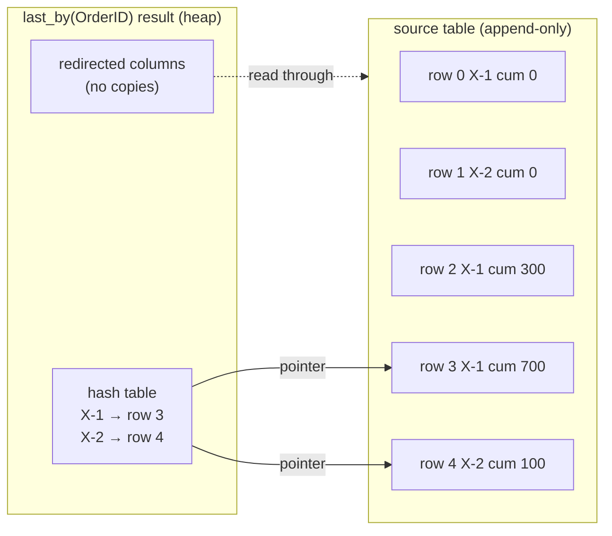

# 12. `last_by` in Deephaven Community and Enterprise: where the bytes are

A `last_by` is the operator the OMS order-tracing design leans on hardest: six of them, one per
order level, hold the latest state of every live order in the Date window (design set,
[06 Scaling and sharding](06-scaling-and-sharding.md) §1). The same note is published in the
[comparison repository](https://github.com/crazymatthsu/deephaven-community-vs-enterprise/blob/main/docs/last-by-memory-model.md).
This note answers two questions that came up while sizing the lineage worker:

1. Is a `last_by` result an in-memory table?
2. Why does the heap of the lineage worker scale with **orders** and not with **messages**?

The short answer: Community and Enterprise run the **same engine** (Core+ is Community Core
plus the Enterprise services), so `last_by` is implemented once and behaves the same way in
both. What differs is **what the source table is**, and that decides whether the operator's
index-not-copy design saves memory or not.

## 1. What a `last_by` result is

The engine does not build a new table with its own column arrays. It keeps

- a **hash table** from key (`OrderID`) to the row position of the latest row for that key in
  the source table (a *row redirection*), and
- **redirected column sources**: a read of `CumQty` for order X follows the pointer and reads
  the value from the source table's column.

Per distinct key the heap holds the key itself, the hash entry and one `long`. It does not hold
the row's columns. Each update cycle processes only the rows the source added since the last
cycle, hashing their keys and moving pointers.



The heap cost of the result is therefore proportional to **distinct keys**, whatever the number
of rows scanned. Where the **rows themselves** live is the source table's business, and that is
the whole difference between the three cases below.

## 2. Three sources, three memory profiles

```mermaid
flowchart TB
    subgraph E["Enterprise lineage PQ  ·  source = db.live_table over a DIS partition"]
        direction LR
        E1[("OMS_RAW.OrdersB<br/>intraday partition<br/>column files on disk")]
        E2["Table Data Service<br/>page cache (memory-mapped, evictable, off-heap)"]
        E3["last_by(OrderID)<br/>hash table + redirection<br/>~110 B per order on heap"]
        E1 --> E2 --> E3
    end
    subgraph C1["Community demo  ·  source = new_table in process (mock / files)"]
        direction LR
        C1a["every message as Java column arrays<br/>on heap"]
        C1b["last_by(OrderID)<br/>hash table + redirection<br/>points into the same heap"]
        C1a --> C1b
    end
    subgraph B["Either edition  ·  source = blink table (AMPS in-worker source, Kafka blink, TablePublisher)"]
        direction LR
        B1["rows live for one update cycle,<br/>then are gone"]
        B2["last_by(OrderID)<br/>copies the latest row's values<br/>into result columns it owns"]
        B1 --> B2
    end
    classDef disk fill:#e8f1fb,stroke:#3b6ea5,color:#000
    classDef heap fill:#fdebd0,stroke:#b9770e,color:#000
    classDef copy fill:#f9e0e0,stroke:#a93226,color:#000
    class E1,E2 disk
    class E3,C1a,C1b heap
    class B1,B2 copy
```



| | Source table | Where the message rows live | What the `last_by` result holds | Heap scales with |
|---|---|---|---|---|
| **Enterprise lineage PQ** | `db.live_table("OMS_RAW", "OrdersX")`: the intraday partition the DIS writes | column files on disk, paged by the Table Data Service through a memory-mapped, evictable page cache; not Java heap | the key, the hash entry, one row pointer per order | **distinct orders** in the window |
| **Community demo** (`OMS_TRACE_SOURCE=mock` or `files`) | `new_table(...)` from the whole book | Java column arrays on heap, every message | the same index, pointing into the same heap | **messages**: the index saves nothing because the source is already resident |
| **Blink source** (AMPS in-worker mirror, a Kafka blink table, any `TablePublisher`), either edition | a blink table: rows exist for one update cycle | nowhere after the cycle ends | **a copy** of the latest row per key, in columns the aggregation owns | distinct orders × row width |

Community also has disk-backed sources: Parquet- and Iceberg-backed tables are region-based
and lazily read, so a `last_by` over them is in the first row of the table above. What
Community lacks is the Data Import Server that writes a live, append-only partition that other
workers can read while it is still being written. That is the Enterprise piece the lineage PQ
depends on, not the operator.

### Why the blink case copies

A blink table's rows are removed at the end of the cycle that added them. A redirection into
them would point at rows that no longer exist, so the engine special-cases aggregations over
blink tables: the first-by and last-by operators **materialize** the surviving row's values
into result columns. Two consequences follow, both visible in the order-tracing implementation:

- A `last_by` over a blink table is a true in-memory table, one full row per key, so its heap
  is distinct keys × row width (a few hundred bytes for the raw contract), not ~110 B per key.
- An aggregation created **after** rows flowed through a blink table never sees them: there is
  nothing left to re-read. This is the rule recorded in
  [04 Lineage and drift DAG](04-lineage-and-drift-dag.md) §10b after a flaky equality test (state views must exist before the first publish).

## 3. "Start-up CPU, not resident memory"

The lineage PQ restarts daily (00:15) and may restart during the trading day. On start,
`db.live_table` returns the partition with every message written so far: tens of millions of
rows at the confirmed volume. `last_by` reads each of them **once**, hashes `OrderID` and moves
the pointer when it finds a later state.

```mermaid
sequenceDiagram
    participant DIS as OMS_RAW partition (disk)
    participant TDS as Table Data Service (page cache)
    participant LB as last_by(OrderID) (heap)
    Note over DIS,LB: start-up pass, once
    loop every row written so far (tens of millions)
        DIS->>TDS: page in
        TDS->>LB: key, row position
        LB->>LB: hash key; pointer = latest row
    end
    Note over LB: one entry per distinct order remains
    Note over DIS,LB: steady state, every update cycle
    DIS->>TDS: rows added since last cycle
    TDS->>LB: keys of the new rows only
    LB->>LB: insert or move pointers
```

When the pass finishes the heap holds one entry per distinct order, whether that order had one
message or two hundred. The history was scanned and released, not retained; the pages it lived
in are evictable and are paged back in only if a pointer still needs them. From then on each
cycle costs the new rows only. The pass is why `pq/oms-lineage.json` has a one-hour init
timeout and why [06](06-scaling-and-sharding.md) §8 budgets recovery time
separately from heap.

## 4. What this means for the order-tracing sizing

The per-node estimate in [06](06-scaling-and-sharding.md) §1.2 (~360 B per
node with string ids: `last_by` ~110 B, parent-side join hash entry ~90 B, child-side `agg_by`
state ~90 B, carried `RootId` ~10 B, row-set overhead ~60 B) and the resulting ~54 GB for ~150 M
resident nodes assume the **first** row of the table: the lineage PQ on Enterprise reading the
DIS-backed table. Two corollaries:

- **Do not size production on the Community demo.** With `mock` or `files` the whole book is on
  heap by construction; the demo exists to show the tables and the logic, not the footprint.
- **Keep the AMPS client as transport.** `OMS_TRACE_SOURCE=amps` runs the lineage over the
  source's blink tables, which puts it in the third row: every `last_by` copies full rows.
  The design therefore persists AMPS messages through the Derived Table Writer into `OMS_RAW`
  ([11 AMPS SOW source](11-amps-sow-source.md), decisions D16 and D17) and lets the
  lineage PQ read the disk-backed table like the Kafka path, unchanged.

Three engine facts round this off and hold in both editions:

- `view` and `update_view` are formulas computed on read; the adapter views cost nothing per
  row. `select` and `update` materialize and stay off the big tables (design decision D8).
- A `where` holds a row set, compact for dense matches; the per-level split on
  `ParentOrderID` over an append-only source is cheap.
- The page cache has its own size setting on the worker, separate from heap. Too small and the
  start-up pass and the link joins thrash on disk, which presents as a slow start rather than
  an out-of-memory error.

## 5. Checklist items this adds to the Enterprise test environment

| # | Item | Evidence |
|---|---|---|
| 1 | Heap of `oms-lineage` after the start-up pass on one real day, against the ~360 B/node estimate | worker heap metrics, node counts from `trace_stats` |
| 2 | Start-up pass duration against the recovery model (06 §8) | PQ initialisation time in the Query Monitor |
| 3 | Page cache size on the query node versus the working set of the six partitions | TDS cache statistics; no sustained disk reads in steady state |
| 4 | Confirm on 2026.01.054 that `db.live_table` over a DIS partition is served through the region-based column sources (the first row above) and not materialized | engine documentation / a heap histogram on the worker |

The byte figures are estimates from the engine's data structures and are marked as such in the
design set; items 1 to 4 turn them into measurements.
